# ElecKoi教程

## 项目介绍

ElecKoi 是围绕 Agent 重新设计的 AI 角色扮演应用，由 DSH 驱动，支持 Windows 和 Android。SLG 和复杂前端卡可以用剧情变量、脚本和自定义界面组合实现。

[GitHub 项目主页](https://github.com/eleckoi/ElecKoi)

## 下载与安装

- [Windows 电脑端](#windows-电脑端)
- [Android 手机端](#android-手机端)

### Windows 电脑端

在 [GitHub 发布页][eleckoi-releases] 的「下载」中选择 **Windows x64 安装包**。也可以在 QQ 搜索群号 `1041463229`，到群文件下载。

<figure class="package-preview">
  
  <figcaption><code>ElecKoi-版本号-x64-setup.exe</code></figcaption>
</figure>

双击下载的 `.exe`，按安装窗口的提示完成安装。

### Android 手机端

在 [GitHub 发布页][eleckoi-releases] 的「下载」中选择 **Android ARM64 标准版**。也可以在 QQ 搜索群号 `1041463229`，到群文件下载。

标准版无法正常启动时，可以试 **Android ARM64 兼容版**。

<figure class="package-preview">
  
  <figcaption>
    <code>ElecKoi-版本号-android-arm64-standard.apk</code>
    <code>ElecKoi-版本号-android-arm64-compat.apk</code>
  </figcaption>
</figure>

在手机上打开下载的 `.apk`，按系统提示完成安装。

[eleckoi-releases]: https://github.com/eleckoi/ElecKoi/releases

## 软件使用

- [Windows · 新手玩家](#新手玩家-windows-电脑端)
- [Windows · 酒馆玩家](#酒馆玩家-windows-电脑端)
- [Android · 新手玩家](#新手玩家-android-手机端)
- [Android · 酒馆玩家](#酒馆玩家-android-手机端)

### 新手玩家 Windows 电脑端

1. [模型配置](#模型配置)：连接一个能回复的聊天模型。
2. [导入角色卡](#导入角色卡)：导入一张现成的卡，试一次对话。
3. [创作角色卡](#创作角色卡)：从角色资料、设定和开场白开始写自己的卡。
4. [许愿式 Agent 写卡](#许愿式-agent-写卡)：把角色构想交给创作工作室的 AI，检查并修改结果。
5. [角色卡导出](#角色卡导出)：把完成的角色保存为 PNG 或 ZIP。

#### 模型配置

##### 1. 认识模型页面

- **`A` 模型入口**：点击导航栏中的「模型」，打开模型配置列表。
- **`B` 新建配置**：模型列表上的 `+` 会打开新建菜单。Windows 上，它在搜索框右边。
- **`C` 默认 DeepSeek**：DSH 已预置 DeepSeek 的接口和模型目录。用 DeepSeek 时，可以直接选中这一项并填写自己的 [API Key](#api-key)。清空自定义内容会恢复默认设置，内置配置仍会保留。
- **`D` 配置详情**：选中一项就能看到它的配置。Windows 上，这块区域在右侧。下面从上往下认识这些字段，截图以自定义提供商为例。

**配置名称和 Provider ID**

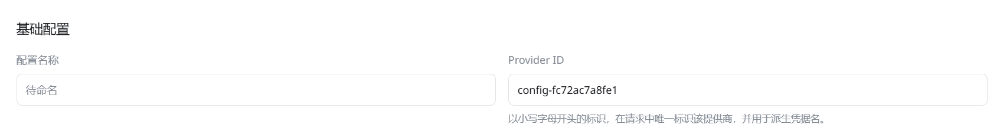

- **配置名称**是你在列表里看到的名字。写个一眼能认出来的，比如「谷歌模型 · XX 中转」或「XX 提供商 · 日常聊天」。
- **[Provider ID](#provider-id)** 是 DSH 用来认这套配置的编号。选定模型后，DSH 用这个编号找到对应的连接配置，再按配置取出保存的密钥。可以保留自动生成的 `config-…`，也可以在新建时填一个唯一的 `google-relay-xx`。用小写字母开头，后面可以用小写字母、数字和连字符。

**接口格式**

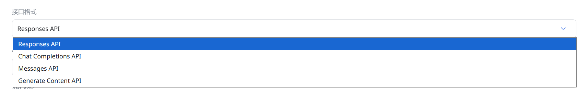

[接口格式](#接口格式)就像插头，插错孔就用不了。看你用的网站写的是哪种接口。比如它写 `/v1/chat/completions`，你就选 **Chat Completions API**。

**API 地址和 API Key**

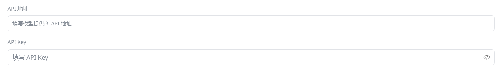

- **[API 地址](#api-地址)** 像收件地址，告诉 ElecKoi 把请求发到哪。比如服务商给出的基础地址是 `https://relay.example/v1`，就把它填进「API 地址」。自定义配置需要填写服务商给的地址，内置配置通常可以沿用默认地址。
- **[API Key](#api-key)** 像进门时刷的通行证，服务商靠它确认这次请求有调用权限。把服务商控制台里生成的 Key 原样贴进「API Key」栏。`YOUR_API_KEY` 是示例占位符，实际要换成自己的 Key。分享截图时记得遮住它。

**模型列表**

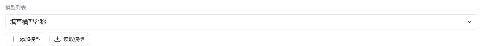

- **选模型**：点下拉框，选已有的模型。比如默认 DeepSeek 列表里的 `deepseek-flash`。
- **读取模型**：让 ElecKoi 向当前服务商查询模型列表。内置目录已经有你要的模型时，直接选就行。
- **添加模型**：服务商已经开通的新模型还没出现在列表里时，可以手动添加。比如服务商给出的 [模型 ID](#模型-id) 是 `example-model-preview`，就按原样填。手动添加后会自动选中。

**模型参数**

先选模型再设参数。可以把这组参数想成导演给演员拍一场戏。桌上放多少剧本、什么时候整理前情、这场戏说多少台词，以及临场发挥的空间，都可以分别调整。第一次配置可以沿用默认值。

- **[上下文窗口](#上下文窗口)** 是桌上能摊开的剧本大小。角色设定、对话历史和这轮输入都占空间。假如服务商标明模型支持 100,000 token，就可以填 `100000`。
- **[自动压缩阈值](#自动压缩阈值)** 是桌面快满时整理前情的时机。ElecKoi 默认按上下文窗口的 80% 计算。比如窗口是 `100000`，阈值默认是 `80000`，达到阈值时会触发前情摘要。
- **[单次最大输出](#单次最大输出)** 是这次最多能写多少台词。举例填 `2048`，就是给这一轮生成设置 2,048 token 的上限，留空由服务商决定。
- **[推理强度](#推理强度)** 像开拍前给演员多少时间琢磨这场戏。比如需要处理多条剧情线时，可以试试服务商支持的「高」档。更高档位可能花更多时间和 token。
- **[温度](#温度)** 越低，模型越倾向用常见的说法。越高，越容易换个说法，同样的问题也更可能答得不一样。
- **[Top P](#top-p)** 越低，模型能选的词越少，主要从最可能的词里挑。越高，能选的词越多，也可能用到平时不太会用的词。

**模型能力和支持推理档位**

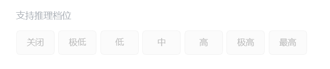

- **[输入能力](#输入能力)**：自定义地址上的模型是否能识图，需要你按提供商或中转站的技术文档确认。例如文档写当前接口接受文字和图片，就勾「文本」和「图片」。只支持文字时，勾「文本」即可。
- **支持推理档位**：在这里声明服务商实际支持哪些档。比如文档只列 `low` 和 `high`，就选「低」和「高」。上面的「推理强度」再从已支持的档位里选本次用哪一档。内置目录有能力说明时可以沿用目录默认。

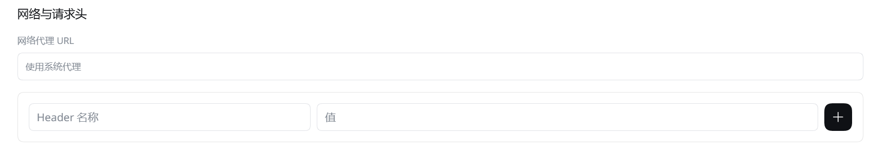

**网络代理**

[网络代理](#网络代理)决定请求从哪条路发出去。比如公司规定访问外部 API 要走公司的代理，电脑设好后，启动 ElecKoi 就会沿用系统代理。这一栏不用填。

**请求头**

服务商的文档写着「加到 Header」，才填到[请求头](#请求头)这里。比如 Anthropic 有些测试功能要加 `anthropic-beta`。在「Header 名称」填 `anthropic-beta`，在「值」填文档给的功能名，再点 `+`。温度、Top P 这类模型参数通常放在请求正文里，直接用上面的「模型参数」设置。[Anthropic 测试功能文档](https://platform.claude.com/docs/en/api/beta-headers)

##### 2. 如何新建模型配置

在「模型」页点击 `+`「新建模型配置」，再在「内置提供商」下展开「从 DSH 目录选择」，选你已开通的[模型提供商](#模型提供商)。

如果目录里没有你的提供商，选择菜单里的「自定义提供商」。

##### 3. 填写配置

- [**自定义提供商**（第三方中转看这里教程）](#自定义提供商配置)
- [**默认 DeepSeek**（官方APIkey看这里教程）](#默认-deepseek-配置)
- [**从 DSH 目录添加的提供商**](#dsh-内置提供商配置)

##### 自定义提供商配置

点击模型列表旁的 `+`，选择「自定义提供商」。「配置名称」可以填「XX 中转」，Provider ID 用自动生成的就行。

**填 API 地址和 API Key**

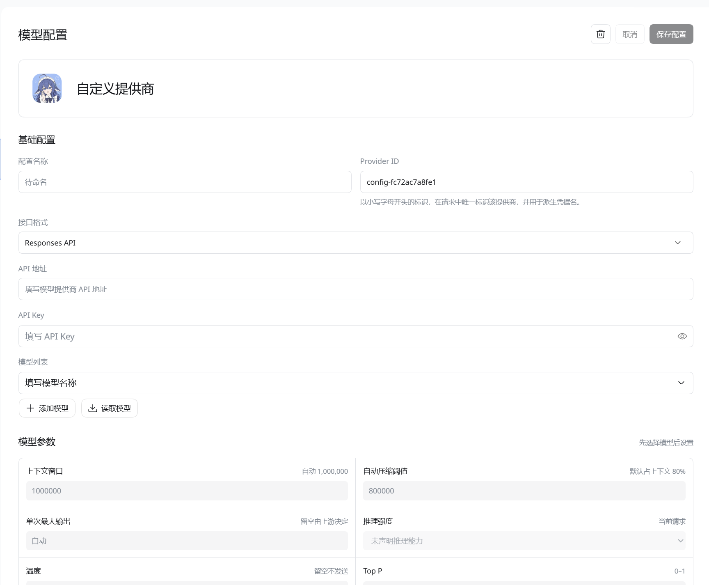

- **[API 地址](#api-地址)** 填提供商给你的基础地址（Base URL）。图里选的是 **Responses API**，用 DeepSeek 官方地址 `https://api.deepseek.com` 演示。用中转站时，填它给你的地址，带 `/v1` 或 `/v1beta` 也照原样填。[DeepSeek Responses API 文档](https://api-docs.deepseek.com/guides/responses_api/)
- **[API Key](#api-key)** 填你在同一个提供商网站复制的密钥。图里的 `demo-key-123456` 是虚构的，实际填写时换成自己的 Key。

**选接口格式**

打开提供商的接入文档，找你要用的模型支持哪种接口。如果文档只给了请求示例，可以看 URL 的结尾来对照。

- **Responses API** 是 OpenAI 的接口格式之一。文档写 `/responses`，就选它。[OpenAI Responses](https://developers.openai.com/api/reference/resources/responses/methods/create)
- **Chat Completions API** 也是 OpenAI 的接口格式，很多兼容服务也用它。文档写 `/chat/completions`，就选它。[OpenAI Chat Completions](https://developers.openai.com/api/reference/resources/chat/subresources/completions/methods/create)
- **Messages API** 是 Anthropic 的 Claude 接口常用的格式。文档写 `/messages`，就选它。[Anthropic Messages](https://platform.claude.com/docs/en/api/messages/create)
- **Generate Content API** 是 Google Gemini 的原生接口格式。文档写 `:generateContent` 或 `:streamGenerateContent`，就选它。[Google Gemini Generate Content](https://aistudio.google.com/api-reference/generate-content)

同样是 Gemini，走 Google 原生接口时选 **Generate Content API**。走 Google 的 OpenAI 兼容接口，或者中转站给这个模型的接口是 `/chat/completions` 时，就选 **Chat Completions API**，并填那个接口对应的 API 地址。[Google 的 OpenAI 兼容文档](https://aistudio.google.com/docs/openai)

**选模型**

点「读取模型」，从返回的列表里选要用的[模型](#模型)。如果服务商的列表暂时没有你要的模型，可以点「添加模型」，照抄服务商提供的完整 [模型 ID](#模型-id)。添加后会自动选中。

##### 默认 DeepSeek 配置

**在官网获取 API Key**

登录 [DeepSeek 开放平台的 API keys 页面](https://platform.deepseek.com/api_keys)，点击「创建 API key」。

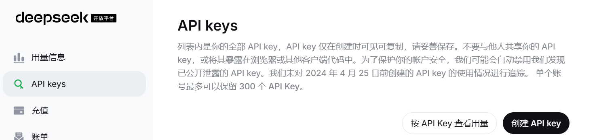

给密钥起个名字，例如「ElecKoi专用」，点击「创建」。看到密钥后，点击「复制」。

**保管好 API Key。** 完整密钥只在创建时显示。不要发给别人，也不要把它露在截图、聊天记录或代码里。

**在 ElecKoi 填写 API Key**

在「模型」页选中列表里自带的「DeepSeek」，把刚复制的 [API Key](#api-key) 粘贴到「API Key」输入框。

DeepSeek 已自带模型目录，展开「模型列表」直接选用即可，无需点「读取模型」。

##### DSH 内置提供商配置

在「从 DSH 目录选择」里选你的提供商，比如 `opencode-go`。把从该提供商复制的 [API Key](#api-key) 粘贴到「API Key」输入框。

接口格式和 API 地址用默认值。保留「使用内置模型目录」的勾选，直接从模型列表里选。

#### 导入角色卡

**找到导入入口**

打开「角色」页。Windows 点搜索框右边的 `+`，Android 点右上角的「角色操作」，然后选「导入角色卡」。

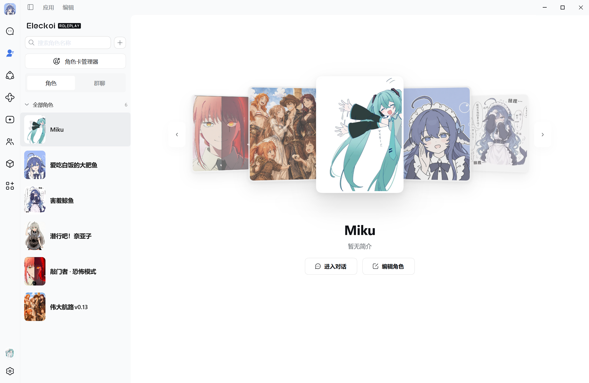

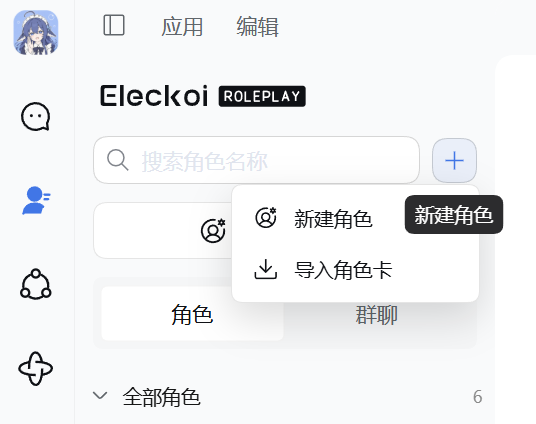

**选卡的来源**

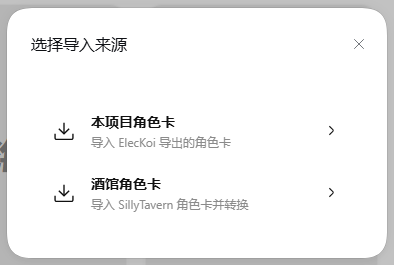

- **本项目角色卡**：选 ElecKoi 导出的[角色卡](#角色卡)。
- **酒馆角色卡**：选 SillyTavern 的 PNG 原图或 JSON 文件，ElecKoi 会转换卡里的数据。

**酒馆角色卡导入注意事项**

- 酒馆世界书的[插入深度](#插入深度)**会被忽略**，条目本身仍会导入。往旧消息里插设定，效果因模型而异，还可能降低缓存复用。我们反复权衡后，保留了「用户最新输入」前后两个常用位置。[查看具体原因](#为什么忽略插入深度)
- **依赖酒馆助手接口的脚本不会导入。** 这类脚本需要在 [AI 创作工作室](#许愿式-agent-写卡) 里适配。

选好文件后，先看预览里的角色名和转换提示，再点「导入」。导入的卡会出现在角色列表里，打开它就能「进入对话」。

**酒馆卡会带过来什么？**

角色描述和世界书会进入「设定库」，开场白会进入「开场白」，能识别的变量和正则也会转换。

#### 创作角色卡

1. 打开「角色」，在角色列表的操作菜单里选择「新建角色」，打开新角色的编辑界面。
2. 在「基础资料」填写名字和简介，在「设定库」写下角色身份、说话风格或故事背景。
3. 在「开场白」写下角色的第一句话，保存后进入对话检查效果。

#### 许愿式 Agent 写卡

1. 打开「AI 创作工作室」，新建对话，选择上一步创建的角色。
2. 直接说你想做什么。例如「把这个角色写成灯塔守夜人，语气冷静。在设定库写一条背景设定，再写一条开场白，保留角色名字。」
3. Agent 执行后，到角色编辑器查看设定库和开场白。还想改哪里，就在同一工作室对话里说明。

#### 角色卡导出

1. 在「角色」里找到完成的角色，打开该角色的操作菜单。
2. 选择 PNG 或 ZIP 导出，保存[角色卡](#角色卡)文件。

### 酒馆玩家 Windows 电脑端

- [模型配置](#模型配置)

点击左侧边栏的「消息」，进入消息页面。

### 新手玩家 Android 手机端

[查看共用的五步新手教程](#新手玩家-windows-电脑端)

### 酒馆玩家 Android 手机端

- [模型配置](#模型配置)

## 概念词库

### 模型提供商

提供 AI 模型服务的厂商或平台。

在 ElecKoi 新建模型配置时，先选你实际开通服务的平台，再使用那个平台提供的 API Key、地址和模型 ID。

### Provider ID

DSH 用来定位某个提供商连接配置的唯一标识。

在 DSH 的通用模型适配器里，Provider ID 用于选择连接配置。配置中保存着 API 地址、接口格式和凭据引用。ElecKoi 为自定义配置保存密钥时，默认由该 ID 派生凭据名。例如 `google-relay-xx` 对应 `GOOGLE_RELAY_XX_API_KEY`。这是内部凭据名，用户只需在 API Key 栏填写实际密钥。

### 接口格式

客户端和服务端约定的请求及响应格式，包括路由、字段和流式返回方式。

ElecKoi 的四个选项分别对应 Responses、Chat Completions、Messages 和 Generate Content。以你填写的 API 地址所对应的服务文档为准，同一款模型也可能经不同接口提供。[OpenAI Responses](https://developers.openai.com/api/reference/resources/responses/methods/create) · [OpenAI Chat Completions](https://developers.openai.com/api/reference/resources/chat/subresources/completions/methods/create) · [Anthropic Messages](https://platform.claude.com/docs/en/api/messages/create) · [Gemini Generate Content](https://aistudio.google.com/api-reference/generate-content)

### API Key

模型服务发放给账户或项目的凭据，客户端在调用 API 时用它通过鉴权。

服务端据此识别请求归属，并按服务规则检查权限、记录用量。Key 的用法像一张单独的通行证，可以在服务商控制台管理或撤销。填写从控制台获得的密钥，妥善保管。

### API 地址

用于构造模型请求 URL 的基础地址（Base URL）。

地址包含服务的域名，也可能带 `/v1` 等路径。ElecKoi 的适配器依据所选接口格式使用相应的请求路径。为内置提供商配置时可先用默认地址。自定义配置填写服务商给出的基础地址。

### 模型

读取对话内容并生成 AI 回复的程序。

同一个模型提供商通常有多个模型。模型影响回复风格、速度和使用费用，角色设定则决定它在对话里扮演谁。

### 模型 ID

提供商用来识别具体模型或模型版本的字符串。

手动添加时使用当前服务文档或模型列表返回的完整 ID，包括服务商规定的版本后缀。同一模型在不同平台上的 ID 可能不同。[Gemini 模型列表接口](https://aistudio.google.com/api-reference/models)

### 上下文窗口

模型在一次请求中能处理的上下文容量，以 token（模型处理文本等内容的计量单位）计。

系统提示、角色设定、历史消息和当前输入都会用掉上下文预算。上下文与输出如何共享限额，以具体服务文档为准。ElecKoi 的设置用于本地估算与管理上下文，实际容量由模型服务决定。[Gemini 模型元数据](https://aistudio.google.com/api-reference/models)

### 自动压缩阈值

ElecKoi 触发对话上下文自动压缩的 token 水位。

界面默认按上下文窗口的 80% 计算。达到阈值时，可以用摘要代替一部分较早的对话上下文，为后续对话留出空间。

### 单次最大输出

一次请求允许生成的 token 上限。

不同接口对输出 token 的计量方式不同，有的也会计入推理 token。在 ElecKoi 留空时使用服务端默认值。[OpenAI Responses](https://developers.openai.com/api/reference/resources/responses/methods/create) · [Anthropic Messages](https://platform.claude.com/docs/en/api/messages/create)

### 推理强度

支持推理的模型在当前请求中使用的推理档位。

档位影响模型分配给推理的计算量，可能影响延迟和用量。「支持推理档位」描述这个模型及接口能接受哪些档位，「推理强度」选择本次请求用的档位。[OpenAI Responses](https://developers.openai.com/api/reference/resources/responses/methods/create)

### 输入能力

模型通过当前接口可以接收的内容类型，例如文本和图片。

能接收图片表示模型可以把图片作为输入来理解，生成图片属于另一种能力。自定义提供商按实际接入平台的模型或接口文档声明。[Gemini Generate Content](https://aistudio.google.com/api-reference/generate-content)

### 温度

控制采样时候选 token 概率分布的参数。

在支持该参数的接口中，较低的温度通常使生成更偏向高概率选项，较高的温度会让低概率选项更容易被采到。留空时 ElecKoi 不主动发送这个参数。[OpenAI Chat Completions](https://developers.openai.com/api/reference/resources/chat/subresources/completions/methods/create)

### Top P

核心采样的累计概率阈值，取值范围为 0 到 1。

采样时按概率从高到低纳入候选，直到累计概率达到阈值，再从这个集合采样。`0.9` 指累计概率约为 90%，关心的是概率总量。留空时使用服务端的默认行为。[OpenAI Chat Completions](https://developers.openai.com/api/reference/resources/chat/subresources/completions/methods/create)

### 网络代理

在客户端和目标服务之间转发请求的网络中间环节。

网络代理决定请求的传输路径。ElecKoi 当前由 DSH 适配器沿用系统代理，模型服务的目的地仍由 API 地址指定。[HTTP Semantics · 中间方](https://www.rfc-editor.org/rfc/rfc9110.html#section-3.7)

### 请求头

随 HTTP 请求一起发送的附加信息，比如接口版本或测试功能开关。

看服务商文档标在哪个位置。`Header` 是请求头，`Body` 是请求正文，`Query` 是 URL 上的参数。ElecKoi 的「自定义请求头」只往请求头里加内容。API Key 照常填在专用的密钥栏。[HTTP Semantics · 字段](https://www.rfc-editor.org/rfc/rfc9110.html#section-5)

### 角色卡

保存一个角色的资料和扮演设定的文件。

角色卡可以包含角色名字、简介、头像和开场白等内容。导入角色卡后，可以在角色列表找到它，再进入对话。

### 插入深度

酒馆世界书用它决定设定插在对话的哪里。D0 在本轮提示词末尾，数字越大，往旧消息里插得越靠前。

酒馆世界书的「扫描深度」决定往回找几条消息里的关键词。正则的「最小深度／最大深度」决定规则对哪几条消息生效。[酒馆世界书文档](https://docs.sillytavern.app/usage/core-concepts/worldinfo/) · [酒馆正则文档](https://docs.sillytavern.app/extensions/regex/)

要调整导入后的设定，打开「编辑角色」里的「设定库」，点开条目，把「触发方式」选成「提示词常驻」。在「插入位置」选一个合适的位置，或者点「管理位置」，在「用户最新输入」上方或下方新建一个位置。酒馆原来放在末尾的 D0 提示可以放在下方。

#### 为什么忽略插入深度

同一段设定放在第几条旧消息旁，不同模型读出来的效果可能不同，很难靠一个固定数字让模型更重视它。[长上下文位置研究](https://aclanthology.org/2024.tacl-1.9/)

比如把设定始终放在倒数第三条消息前，每多一条消息，设定在历史里的位置就会往后挪。提示词缓存只能复用两次请求从开头起一致的部分。设定一挪，这段相同的开头就可能变短。ElecKoi 保留最新输入前后两个位置，常用的提示依然能放在本轮对话附近，也省得数消息。[前缀缓存说明](https://developers.openai.com/api/docs/guides/keep-prefix-unchanged)
