# ElecKoi教程


## 项目介绍

ElecKoi 是围绕 Agent 设计的 AI 角色扮演应用，由 [DeepSeek Harness（DSH）](https://github.com/deepseek-ai/deepseek-harness) 驱动，支持 Windows 和 Android。

创作者可以用剧情变量、脚本和自定义界面制作 SLG 或复杂前端卡。

[GitHub 项目主页](https://github.com/eleckoi/ElecKoi)

## 下载与安装

- [Windows 电脑端](#windows-电脑端)
- [Android 手机端](#android-手机端)

### Windows 电脑端

#### 下载安装包

在 [GitHub 发布页][eleckoi-releases] 的「下载」中选择 **Windows x64 安装包**。也可以在 QQ 搜索群号 `1041463229`，到群文件下载。

<figure class="package-preview">
  
  <figcaption><code>ElecKoi-版本号-x64-setup.exe</code></figcaption>
</figure>

#### 安装 Windows 版

双击下载的 `.exe`，按安装窗口的提示完成安装。

### Android 手机端

#### 选择安装包

在 [GitHub 发布页][eleckoi-releases] 的「下载」中选择 **Android ARM64 标准版**。也可以在 QQ 搜索群号 `1041463229`，到群文件下载。

标准版无法正常启动时，可以试 **Android ARM64 兼容版**。

<figure class="package-preview">
  
  <figcaption>
    <code>ElecKoi-版本号-android-arm64-standard.apk</code>
    <code>ElecKoi-版本号-android-arm64-compat.apk</code>
  </figcaption>
</figure>

#### 安装 Android 版

在手机上打开下载的 `.apk`，按系统提示完成安装。

[eleckoi-releases]: https://github.com/eleckoi/ElecKoi/releases

## 软件使用

- [Windows · 新手玩家](#新手玩家-windows-电脑端)
- [Windows · 酒馆玩家](#酒馆玩家-windows-电脑端)
- [Android · 新手玩家](#新手玩家-android-手机端)
- [Android · 酒馆玩家](#酒馆玩家-android-手机端)

### 新手玩家 Windows 电脑端

1. [模型配置](#模型配置)：连接一个能回复的聊天模型。
2. [导入角色卡](#导入角色卡)：导入一张现成的卡，试一次对话。
3. [创作角色卡](#创作角色卡)：从角色资料、设定和开场白开始写自己的卡。
4. [许愿式 Agent 写卡](#许愿式-agent-写卡)：把角色构想交给创作工作室的 AI，检查并修改结果。
5. [角色卡导出](#角色卡导出)：把完成的角色保存为 PNG 或 ZIP。

#### 模型配置

##### 1. 认识模型页面

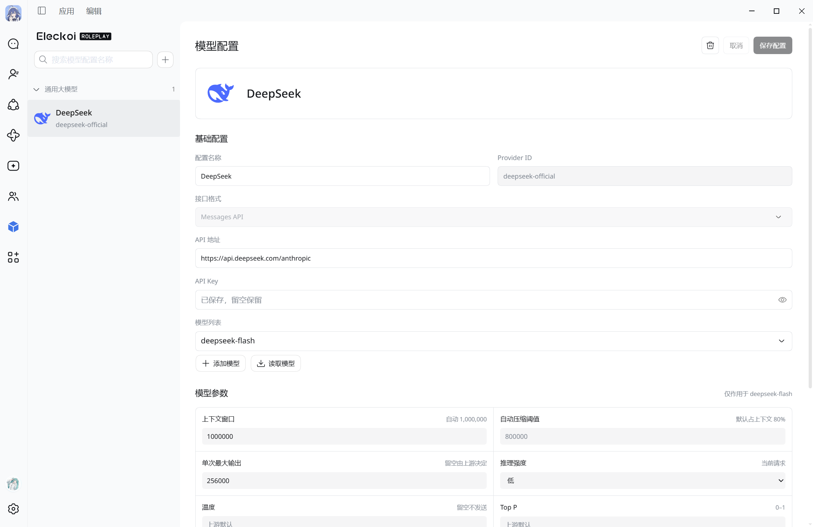

- **`A` 模型入口**：点击导航栏中的「模型」，打开模型配置列表。
- **`B` 新建配置**：模型列表上的 `+` 会打开新建菜单。Windows 上，它在搜索框右边。
- **`C` 默认 DeepSeek**：DSH 已预置 DeepSeek 的接口和模型目录。用 DeepSeek 时，可以直接选中这一项并填写自己的 [API Key](#api-key)。清空自定义内容会恢复默认设置，内置配置仍会保留。
- **`D` 配置详情**：选中一项就能看到它的配置。Windows 上，这块区域在右侧。下面从上往下认识这些字段，截图以自定义提供商为例。

<h6 class="tutorial-subsection-title">配置名称和 Provider ID</h6>


- **配置名称**是你在列表里看到的名字。写个一眼能认出来的，比如「谷歌模型 · XX 中转」或「XX 提供商 · 日常聊天」。
- **[Provider ID](#provider-id)** 是 DSH 用来找到连接配置和密钥的编号。

    可以保留自动生成的 `config-…`。自己填时，用唯一的编号，比如 `google-relay-xx`。用小写字母开头，后面可以用小写字母、数字和连字符。

<h6 class="tutorial-subsection-title">接口格式</h6>


[接口格式](#接口格式)就像插头，选项要和提供商的接口对上。

例如文档写 `/v1/chat/completions`，就选 **Chat Completions API**。

<h6 class="tutorial-subsection-title">API 地址和 API Key</h6>


- **[API 地址](#api-地址)** 像收件地址，告诉 ElecKoi 把请求发到哪。比如服务商给出的基础地址是 `https://relay.example/v1`，就把它填进「API 地址」。自定义配置需要填写服务商给的地址，内置配置通常可以沿用默认地址。
- **[API Key](#api-key)** 像通行证，告诉服务商你有调用权限。把服务商控制台生成的 Key 原样贴进「API Key」栏。

    文档里的 `YOUR_API_KEY` 是占位符，填写时换成自己的 Key。分享截图时记得遮住它。

<h6 class="tutorial-subsection-title">模型列表</h6>


- **选模型**：点下拉框，选已有的模型。比如默认 DeepSeek 列表里的 `deepseek-flash`。
- **读取模型**：让 ElecKoi 向当前服务商查询模型列表。内置目录已经有你要的模型时，直接选就行。
- **添加模型**：服务商已经开通的新模型还没出现在列表里时，可以手动添加。比如服务商给出的 [模型 ID](#模型-id) 是 `example-model-preview`，就按原样填。手动添加后会自动选中。

<h6 class="tutorial-subsection-title">模型参数</h6>

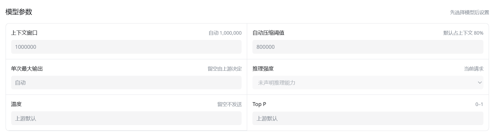

先选模型再设参数。第一次配置可以沿用默认值。

想调整时，可以把它想成给演员安排一场戏。下面分别讲剧本能放多少、什么时候整理前情，以及演员能说多少台词、怎么发挥。

- **[上下文窗口](#上下文窗口)** 是桌上能摊开的剧本大小。角色设定、对话历史和这轮输入都占空间。假如服务商标明模型支持 100,000 token，就可以填 `100000`。
- **[自动压缩阈值](#自动压缩阈值)** 是桌面快满时整理前情的时机。ElecKoi 默认按上下文窗口的 80% 计算。比如窗口是 `100000`，阈值默认是 `80000`，达到阈值时会触发前情摘要。
- **[单次最大输出](#单次最大输出)** 是这次最多能写多少台词。举例填 `2048`，就是给这一轮生成设置 2,048 token 的上限，留空由服务商决定。
- **[推理强度](#推理强度)** 像开拍前给演员多少时间琢磨这场戏。比如需要处理多条剧情线时，可以试试服务商支持的「高」档。更高档位可能花更多时间和 token。
- **[温度](#温度)** 越低，模型越倾向用常见的说法。越高，越容易换个说法，同样的问题也更可能答得不一样。
- **[Top P](#top-p)** 越低，模型能选的词越少，主要从最可能的词里挑。越高，能选的词越多，也可能用到平时不太会用的词。

<h6 class="tutorial-subsection-title">模型能力和支持推理档位</h6>

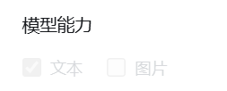


- **[输入能力](#输入能力)**：自定义地址上的模型是否能识图，需要你按提供商或中转站的技术文档确认。例如文档写当前接口接受文字和图片，就勾「文本」和「图片」。只支持文字时，勾「文本」即可。
- **支持推理档位**：在这里声明服务商实际支持哪些档。比如文档只列 `low` 和 `high`，就选「低」和「高」。上面的「推理强度」再从已支持的档位里选本次用哪一档。内置目录有能力说明时可以沿用目录默认。

<h6 class="tutorial-subsection-title">网络代理</h6>


[网络代理](#网络代理)决定请求从哪条路发出去。比如公司规定访问外部 API 要走公司的代理，电脑设好后，启动 ElecKoi 就会沿用系统代理。这一栏不用填。

<h6 class="tutorial-subsection-title">请求头</h6>

服务商的文档写着「加到 Header」，才填到[请求头](#请求头)这里。

例如 Anthropic 有些测试功能会要求加 `anthropic-beta`。在「Header 名称」填 `anthropic-beta`，在「值」填文档给的功能名，再点 `+`。[Anthropic 测试功能文档](https://platform.claude.com/docs/en/api/beta-headers)

温度、Top P 这类参数通常放在请求正文里，直接用上面的「模型参数」设置。

##### 2. 如何新建模型配置

在「模型」页点击 `+`「新建模型配置」，再在「内置提供商」下展开「从 DSH 目录选择」，选你已开通的[模型提供商](#模型提供商)。

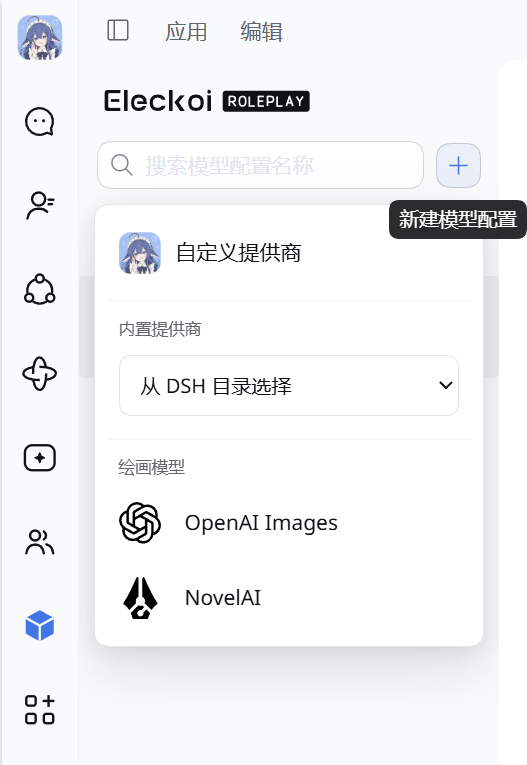

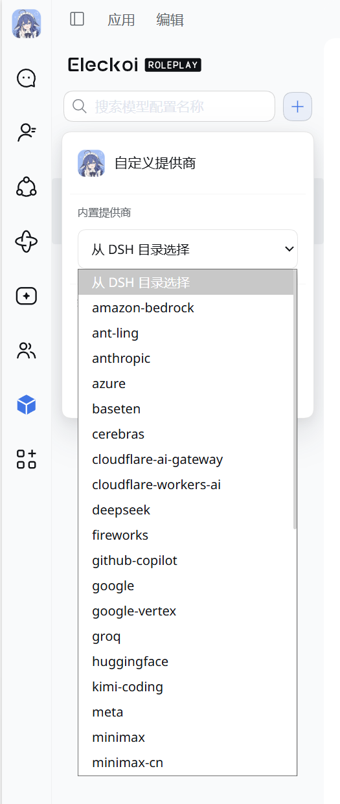

如果目录里没有你的提供商，选择菜单里的「自定义提供商」。

##### 3. 填写配置

- [**自定义提供商**（第三方中转看这里教程）](#自定义提供商配置)
- [**默认 DeepSeek**（官方APIkey看这里教程）](#默认-deepseek-配置)
- [**从 DSH 目录添加的提供商**](#dsh-内置提供商配置)

##### 自定义提供商配置

点击模型列表旁的 `+`，选择「自定义提供商」。「配置名称」可以填「XX 中转」，Provider ID 用自动生成的就行。

<h6 class="tutorial-subsection-title">填 API 地址和 API Key</h6>


- **[API 地址](#api-地址)** 填提供商给你的基础地址（Base URL）。图里选的是 **Responses API**，用 DeepSeek 官方地址 `https://api.deepseek.com` 演示。用中转站时，填它给你的地址，带 `/v1` 或 `/v1beta` 也照原样填。[DeepSeek Responses API 文档](https://api-docs.deepseek.com/guides/responses_api/)
- **[API Key](#api-key)** 填你在同一个提供商网站复制的密钥。图里的 `demo-key-123456` 是虚构的，实际填写时换成自己的 Key。

<h6 class="tutorial-subsection-title">选接口格式</h6>

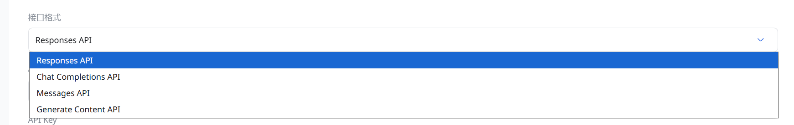

打开提供商的接入文档，找你要用的模型支持哪种接口。如果文档只给了请求示例，可以看 URL 的结尾来对照。

- **Responses API**<br>
  OpenAI 的接口格式。文档写 `/responses`，就选它。[OpenAI Responses](https://developers.openai.com/api/reference/resources/responses/methods/create)
- **Chat Completions API**<br>
  OpenAI 和许多兼容服务使用的格式。文档写 `/chat/completions`，就选它。[OpenAI Chat Completions](https://developers.openai.com/api/reference/resources/chat/subresources/completions/methods/create)
- **Messages API**<br>
  Anthropic Claude 常用的格式。文档写 `/messages`，就选它。[Anthropic Messages](https://platform.claude.com/docs/en/api/messages/create)
- **Generate Content API**<br>
  Google Gemini 的原生格式。文档写 `:generateContent` 或 `:streamGenerateContent`，就选它。[Google Gemini Generate Content](https://aistudio.google.com/api-reference/generate-content)

**用 Gemini 时怎么选？** 走 Google 原生接口，选 **Generate Content API**。

走 Google 的 OpenAI 兼容接口，或中转站给的接口是 `/chat/completions`，选 **Chat Completions API**，再填对应的 API 地址。[Google 的 OpenAI 兼容文档](https://aistudio.google.com/docs/openai)

<h6 class="tutorial-subsection-title">选模型</h6>

点「读取模型」，从返回的列表里选要用的[模型](#模型)。如果服务商的列表暂时没有你要的模型，可以点「添加模型」，照抄服务商提供的完整 [模型 ID](#模型-id)。添加后会自动选中。

##### 默认 DeepSeek 配置

<h6 class="tutorial-subsection-title">在官网获取 API Key</h6>

登录 [DeepSeek 开放平台的 API keys 页面](https://platform.deepseek.com/api_keys)，点击「创建 API key」。


给密钥起个名字，例如「ElecKoi专用」，点击「创建」。看到密钥后，点击「复制」。

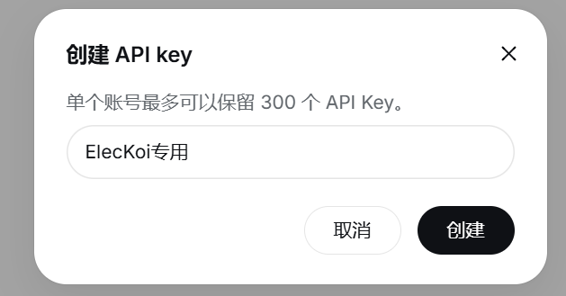

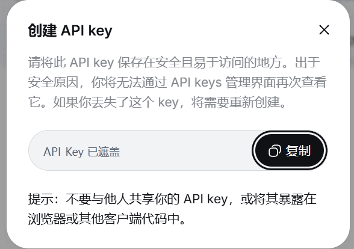

**保管好 API Key。** 完整密钥只在创建时显示。不要发给别人，也不要把它露在截图、聊天记录或代码里。

<h6 class="tutorial-subsection-title">在 ElecKoi 填写 API Key</h6>

在「模型」页选中列表里自带的「DeepSeek」，把刚复制的 [API Key](#api-key) 粘贴到「API Key」输入框。

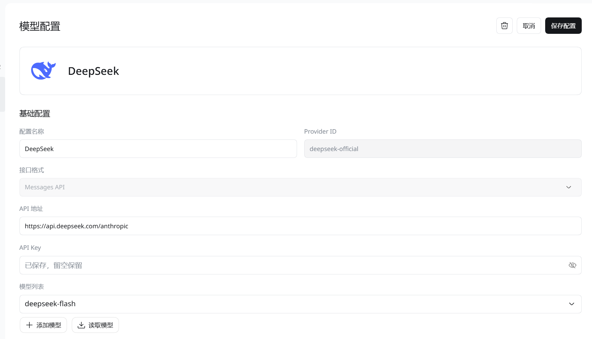

DeepSeek 已自带模型目录，展开「模型列表」直接选用即可，无需点「读取模型」。

##### DSH 内置提供商配置

在「从 DSH 目录选择」里选你的提供商，比如 `opencode-go`。把从该提供商复制的 [API Key](#api-key) 粘贴到「API Key」输入框。

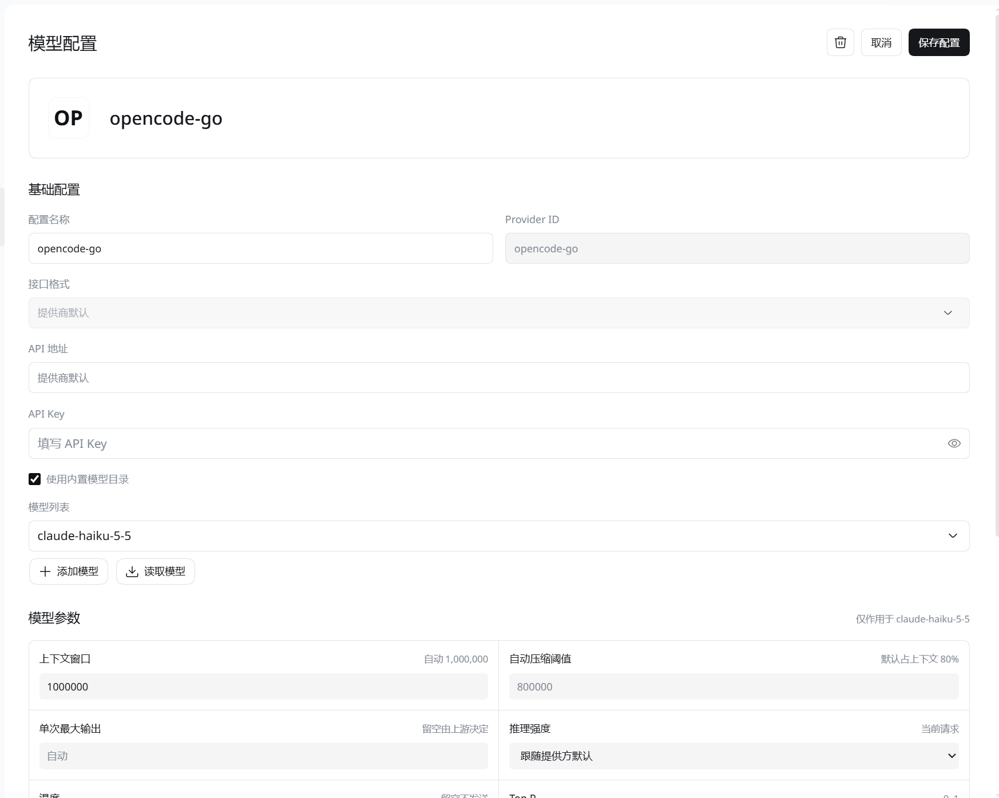

接口格式和 API 地址用默认值。保留「使用内置模型目录」的勾选，直接从模型列表里选。

#### 导入角色卡

##### 1. 打开导入

打开「角色」页。Windows 点卡片目录上方的 **「导入角色」**。Android 点右上角的 **「角色操作」→「导入角色卡」**。

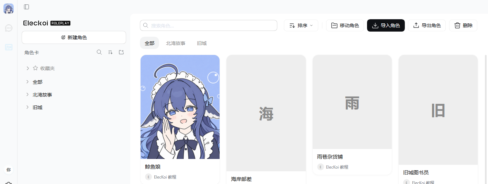

##### 2. 按来源选择文件


- 卡是从 ElecKoi 导出的，就选 **「本项目角色卡」**。一般是 PNG 原文件或 ZIP 包。
- 卡来自 SillyTavern，就选 **「酒馆角色卡」**，再选角色卡的 PNG 原文件或 JSON。单独下载的世界书请走[设定库导入](#import-worldbook)。

##### 3. 检查预览并确认

可以一次选多张卡。以「鲸鱼娘」为例，选中角色卡 PNG 后，预览会显示封面、角色名和转换结果。确认后点 **「导入 1」**。按钮上的数字是本次能导入的卡片数。

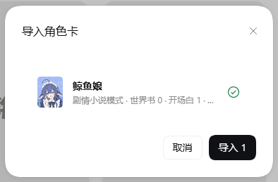

如果提示图片里没有角色卡数据，选回原始角色卡 PNG 或 JSON。单独的封面图片可以在[基础资料](#基础资料)上传。

导入后在「角色」页找到「鲸鱼娘」，点开详情，再点 **「进入对话」**。

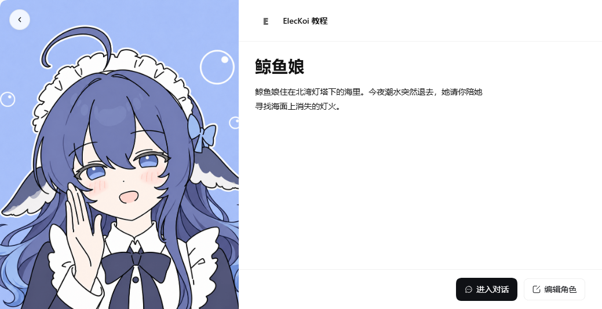

##### 酒馆卡会带过来什么？

角色描述和随卡附带的世界书会进入「设定库」，主开场和备用开场会进入「开场白」。能识别的变量和正则也会转换，可以在预览中看数量和提示。

- 酒馆世界书的[插入深度](#插入深度)**会被忽略**，条目本身仍会导入。需要把设定放在本轮对话附近时，可以改用「用户最新输入」前后的设定插入点。[查看具体原因](#为什么忽略插入深度)
- **依赖酒馆助手接口的脚本不会导入。** 这类脚本需要在 [AI 创作工作室](#许愿式-agent-写卡) 里适配。

#### 创作角色卡

##### 1. 打开「角色」页

点导航栏的「角色」。Windows 右侧是卡片目录，可以用上方标签按分组看卡片，也可以按名字搜索。点一张卡就能打开详情。


##### 2. 新建角色

Windows 上，点左侧的 **「新建角色」**，再在弹出的菜单里选 **「新建角色」**，卡片目录会新增一张「未命名角色」。如果目录筛选在某个角色分组，新角色会建在该组。

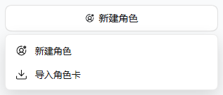

Android 上，点角色页右上角的「角色操作」，再点「新建角色」，就会进入编辑器。

##### 3. 打开角色编辑器

**从角色详情打开。** 在 Windows 的卡片目录点刚建好的「未命名角色」，再点详情页右下方的 **「编辑角色」**。已经建好的角色也从这里进入编辑器。

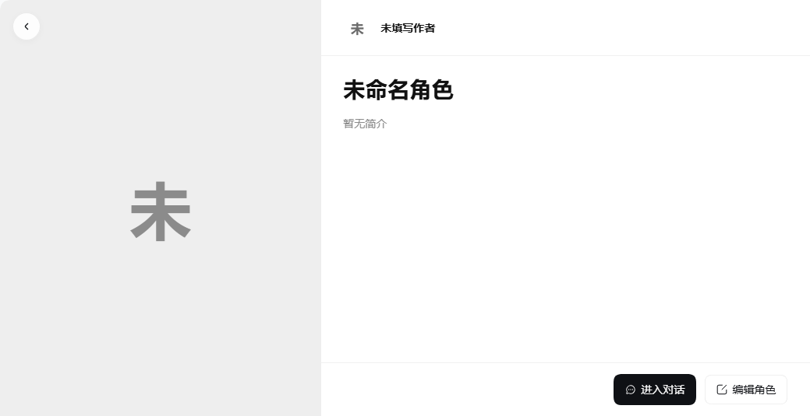

**Windows 也可以用右键菜单。** 右键点目录里那张卡，选「编辑角色卡」。左侧列表里的角色也能右键编辑。

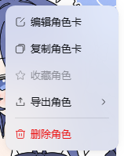

##### 4. 认识角色编辑器

在左侧选功能，右侧就会显示对应的编辑区。第一次写卡，可以先填基础资料、开场白和设定库，再保存并进入对话试一次。

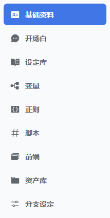

- [**基础资料**　名字、头像、封面和简介](#基础资料)
- [**开场白**　写不同开局，分别绑定变量配置](#开场白)
- [**设定库**　写人设、世界观和玩法规则](#设定库)
- [**变量**　记录好感度、金币等会变化的数据](#变量)
- [**正则**　替换文字，也能用 HTML 美化单条消息](#正则)
- [**脚本**　给角色加自动执行的逻辑或操作面板](#脚本)
- [**前端**　用独立页面替换聊天区和输入框](#前端)
- [**资产库**　存放前端卡用的图片、音频等素材](#资产库)
- [**分支设定**　让 Agent 修改本局设定，保留角色卡主设定](#分支设定)

##### 基础资料

在编辑器左侧选「基础资料」。下面以「鲸鱼娘」为例填写。

**角色信息。** 在「角色名字」填「鲸鱼娘」。点左边的相机图标选头像。头像也会显示在对话里。

**作者信息。** 在「作者名字」填署名，例如「ElecKoi 教程」。也可以上传作者头像。

**封面立绘。** 点「更换图片」选原图。在裁剪窗口拖动图片、滚动鼠标调整大小，确认预览里的取景后点 **「保存」**。这张封面会显示在角色目录和详情里。

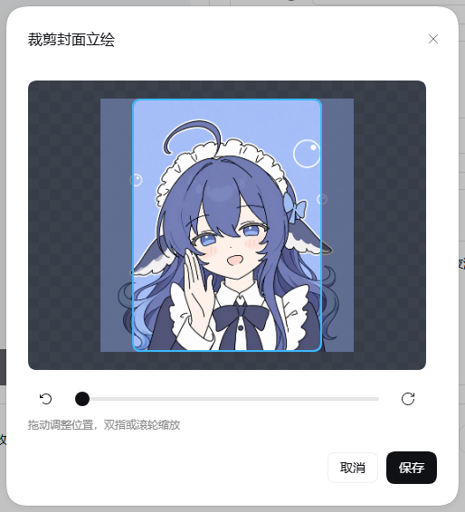

**简介。** 写一段给读者看的故事开头，让人知道角色是谁、接下来要去做什么。

> 鲸鱼娘住在北湾灯塔下的海里。今夜潮水突然退去，她请你陪她寻找海面上消失的灯火。

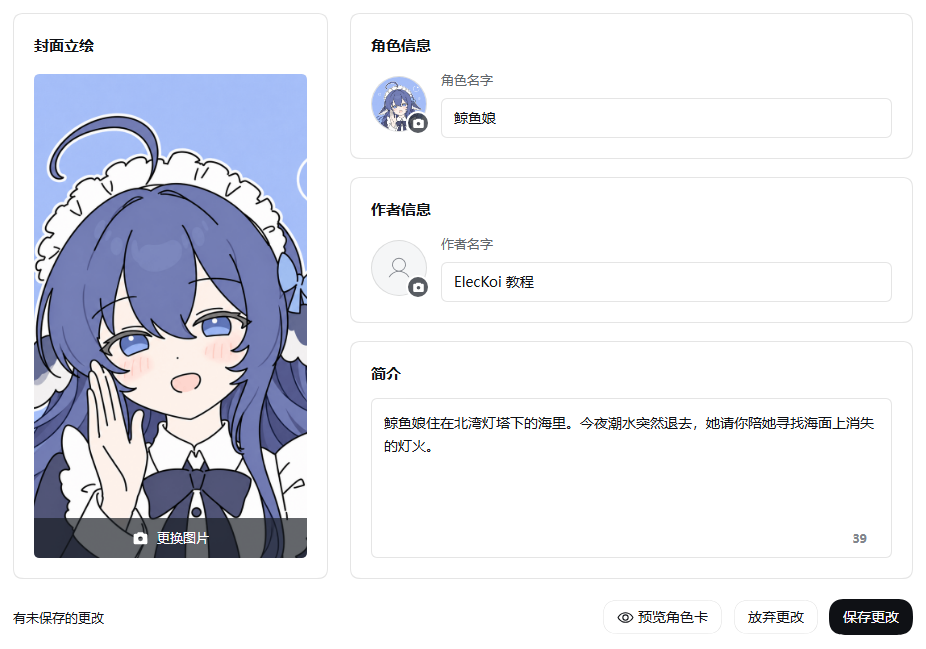

点 **「预览角色卡」** 检查封面有没有裁掉重要部分、角色名和署名是否正确。关闭预览后点 **「保存更改」**。想让角色按特定方式说话和行动，可以接着写[设定库](#设定库)。

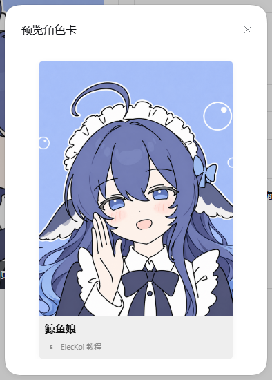

##### 开场白

###### 1. 写一个开场

在角色编辑器里点「开场白」，从列表选中「默认开场」。手机上选中后再点底部的「编辑」。填一个方便辨认的「标题」，再在「开场白正文」里写玩家进入对话时看到的内容。可以写一整段场景、旁白和人物台词。

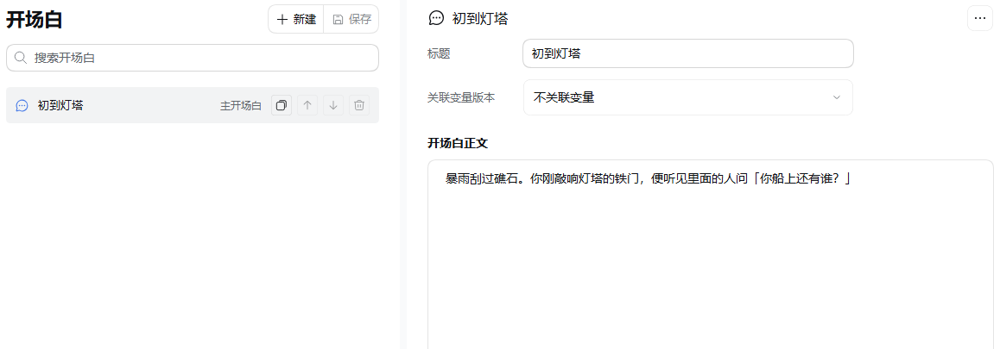

###### 2. 新建其他开局

想让同一个角色有不同的故事起点，就点「新建」。手机上从底部的「新建」菜单选「新建开场白」。给新增的开场白填上标题和正文。比如可以写「初到灯塔」和「老朋友重逢」两个开局。

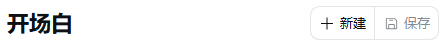

###### 3. 整理开场白顺序

带「主开场白」标记的是新对话默认展示的开场。Windows 选中一条后，点右侧标题旁的 **「…」**，可以复制、上移、下移或删除。把想用的开场白「上移」到第一位，就会成为主开场白。Android 的「上移」在底部的「移动」菜单里。

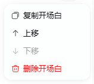

有相似的开局，可以先用「复制开场白」复制一份，再改标题和正文。

###### 4. 给每个开局绑定变量版本

先在[变量](#变量)里准备好配置版本。回到「开场白」，选中要设置的那一条，在「关联变量版本」里选对应版本。只想写剧情时，可以保留「不关联变量」。

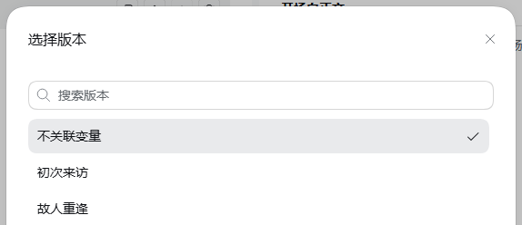

比如「初到灯塔」关联「初次来访」的变量版本，好感度从 `0` 开始。「老朋友重逢」关联「故人重逢」的版本，好感度从 `50` 开始。玩家选哪个开局，这局就使用对应版本的初始值。完成后点「保存」。

##### 设定库

设定库用来写人设、世界观和玩法规则。酒馆玩家把它叫作「世界书」。

左侧的文件夹树也是 AI 找资料用的虚拟目录。把相关设定放在一起，AI 就能像找文件一样，按文件夹和条目名称[查阅需要的设定](#ai-选读)。

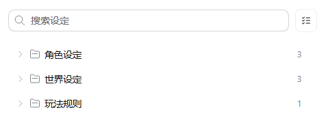

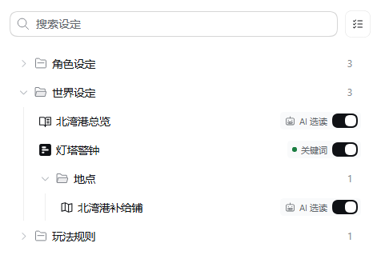

[为什么叫设定库](#为什么叫设定库)　·　[导入已有世界书](#import-worldbook)

###### 1. 认识「角色」和「全局」

<section class="tutorial-illustration-row" markdown="1">

### 角色

只给当前角色用。<br>比如「守夜人很怕黑」。

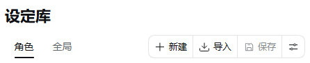

</section>

<section class="tutorial-illustration-row" markdown="1">

### 全局

启用后对所有角色生效。<br>比如「用简体中文回复」。

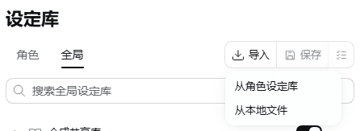

</section>

###### 2. 动手新建一条设定

<div class="tutorial-illustration-row" markdown="1">

在「角色」页点 **「新建」→「新建设定」**，在右侧写正文。人设、世界背景和玩法规则都从这里建。正文可以写普通文字，也可以在文字里混写 EJS。

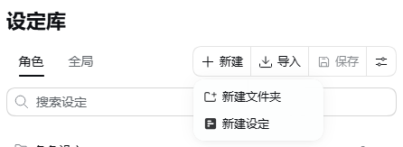

</div>

<p class="tutorial-guide-entry"><a href="#设定">查看设定配置教程 <span aria-hidden="true">→</span></a></p>

<h6 id="import-worldbook">导入已有世界书（可选）</h6>

在角色编辑器里打开「设定库」→「角色」，点目录上方的 **导入图标**。它的名称是「导入角色设定库」。

准备好酒馆导出的世界书 `.json` 文件，按你想要的结果选一种。

- [**导入为新版本**](#导入为新版本)　单独存一套，之后可以切回来。
- [**并入设定库**](#并入当前版本)　把选中的条目加进当前这套。

新版导入会保留酒馆条目的开关、常驻或关键词配置，以及正文里的 EJS。关键词列表留空时，仍按关键词规则处理，聊天扫描时匹配不到。触发规则关闭的条目可以留在设定库里，供其他模板[引用正文](#关闭触发规则后)。

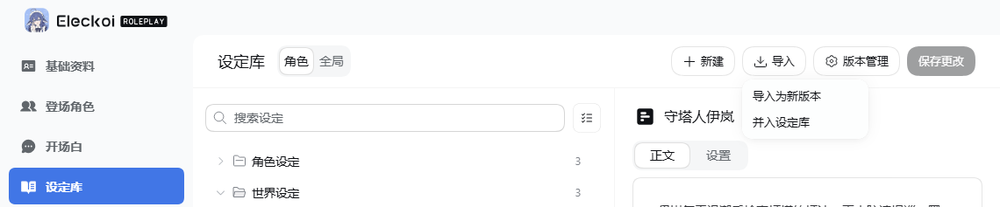

<section class="tutorial-topic" markdown="1">

### 导入为新版本

点「导入为新版本」→「酒馆世界书」，选择导出的 `.json` 文件。

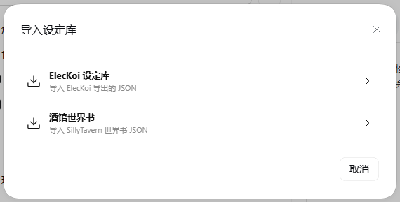

导入后会切到新版本，原来的设定还在旧版本里。回到设定库点「保存」。

</section>

<section class="tutorial-topic" markdown="1">

### 并入当前版本

在目录底部先选好要接收条目的版本。点导入图标，再点 **「并入设定库」**。导入酒馆世界书时，点弹窗底部的 **「从本地文件」**，选择 `.json` 文件。

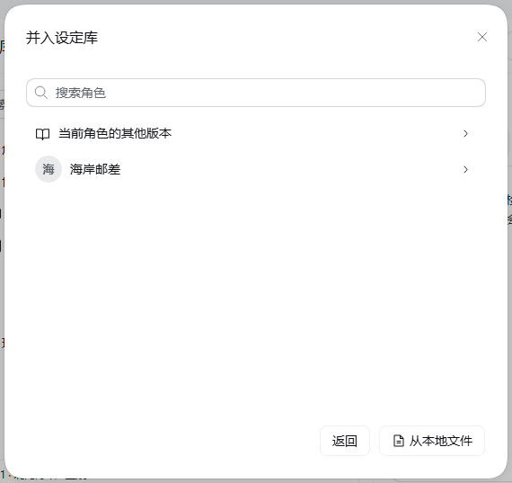

如果想用已有角色的设定，可以在这个弹窗里搜索并选择角色。有多个可用版本时，再选择来源版本。

进入「选择设定」后，搜索或勾选想带走的条目。把「并入位置」设为根目录或当前库里的文件夹，再点「检查并入结果」。

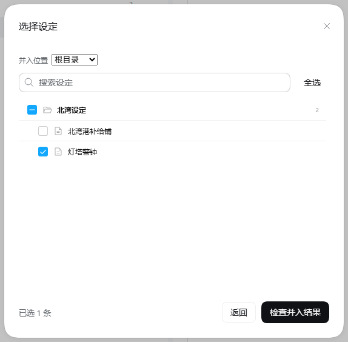

确认后点「并入设定」，再回到设定库点「保存」。

</section>

<section class="tutorial-topic" markdown="1">

### 导入到「全局」

切到「全局」，点 **导入图标 →「从本地文件」**，选好 `.json` 后点「保存」。新导入的库默认启用，之后可以在目录里关掉。导入菜单也可以选「从角色设定库」，搜索来源角色并选择版本。

</section>

###### 设定

<div markdown="1">

## 正文

在设定库的「角色」页点 **「新建」→「新建设定」**，打开「正文」直接写。下面写的是北湾灯塔的守夜人，AI 可以从中知道他平时做什么、怎么待人、遇险时会怎么做。

> 伊岚守着北湾灯塔十年。每天日落前，他会检查灯油、擦镜片，再记下风向。附近的暗礁和避风湾，他闭着眼也能指对方向。
>
> 他和陌生人说话很短，遇到求救的人会先问「船上还有几个人？」有人受伤时，他先把人带进一楼看守室，等大家安全了才追问经过。
>
> 他只说自己亲眼看到或亲耳听到的事。听见警钟时，他会先辨清响了几下，再按灯塔的警钟规则行动。

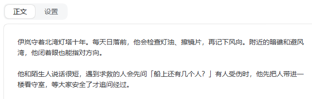

需要根据剧情变化输出不同文字时，可以在这个正文框里[写 EJS](#ejs-in-entry)。

## 基本信息

切到**「设置」**。最上方是「基本信息」，在「名称」填**「守夜人伊岚」**。点名称左边的小图标，可以为条目换一个图标。这个例子选「人物」，回到列表时一眼就能认出来。

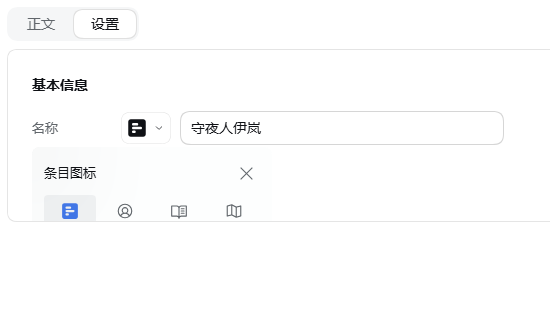

## 触发规则

切到「设置」。新设定的 **「触发规则」默认关闭**，下方的规则配置会收起。打开开关后，「触发方式」才可以选择 **AI 选读**、**关键词触发** 或 **常驻触发**。条目目录右侧的开关也控制这条规则。

### 常驻触发 · 每轮必读

伊岚的说话习惯和救人原则每轮都可能用到。打开「守夜人伊岚」的触发规则，选择 **「常驻触发」→「每轮必读」**，再点「保存」。

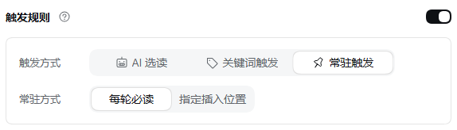

<figure class="tutorial-flowchart">
  
  <figcaption>EJS 输出为空时，本轮跳过这条设定。</figcaption>
</figure>

「守夜人伊岚」写的是普通文字，所以走图里的「缓存设定区」。AI 查这条设定时，工具返回编号和标题，指向已经给它的正文。

### AI 选读

**AI 选读，就是让 AI 像找文件一样，自己查需要的设定。** 设定库左边的文件夹树是 AI 用的**虚拟目录**。文件夹用来分组，条目名称就像文件名。比如把「北湾港补给铺」放进「世界设定」下的「地点」，完整路径就是 `世界设定/地点/北湾港补给铺`。

浏览目录时，AI 能看到**路径、名称和「查阅提示」**。查阅提示就像写在文件旁的一句话，告诉 AI 里面有什么、什么时候值得打开。需要这份资料时，AI 按完整路径读取正文。已经知道路径时，也可以直接打开。

选中这条设定，在「设置」里打开触发规则，选 **「AI 选读」**。把「灯油、绳索去哪买，或想知道补给铺何时开门时查阅」填进「查阅提示」。店的位置、营业时间和具体卖什么，都写在「正文」里，再点「保存」。

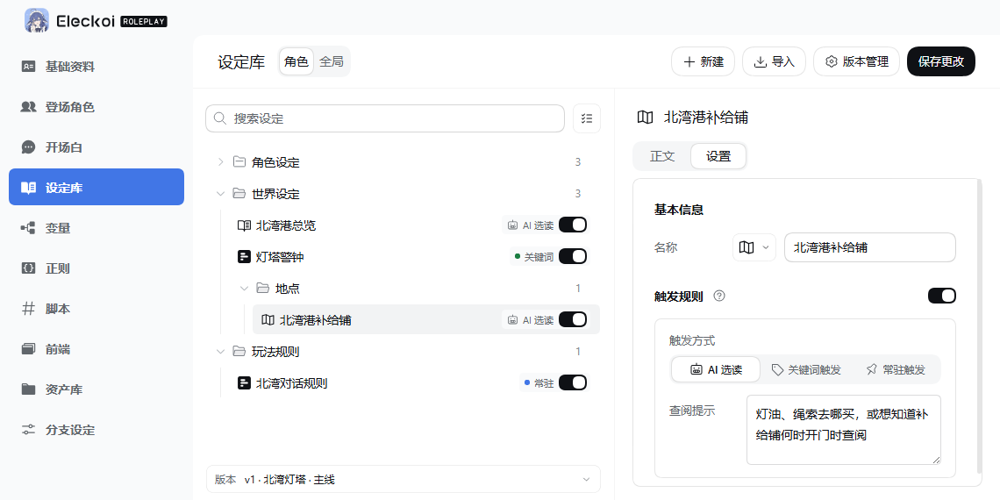

玩家问「灯油去哪买？」时，AI 可以从目录里的查阅提示找到「北湾港补给铺」，打开这一个条目，再根据正文告诉玩家店在哪。本轮用不上的设定可以留在目录里。

<figure class="tutorial-flowchart">
  
</figure>

如果[正文写了 EJS](#ejs-in-entry)，AI 打开这条设定时才会执行模板，读取工具交回生成的文字。

### 关键词触发

给灯塔另建一条「灯塔警钟」。这份规则只在对话提到警钟时用，正文要写清每种钟声对应的行动。

> 警钟响一声，表示港口起大雾。伊岚先检查灯光，再去看守室翻潮汐表。连响三声，表示有船遇险。他要提灯到下层平台，先确认船上人数，再用信号旗指向避风湾。

打开触发规则，选择 **「关键词触发」**。在「触发关键词」依次输入 `警钟`、`三响`，每填一个按一次回车，再保存。

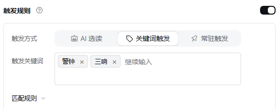

<figure class="tutorial-flowchart">
  
</figure>

用默认扫描深度 `1` 试一试。发「警钟响了三下」，其中有「警钟」，这条设定会列为本轮必读。发「我走进灯塔」则没有命中。填了多个触发关键词，碰到其中一个就能通过主关键词这一关。

### 匹配规则

在「匹配规则」里，从上到下看这三组设置。点「匹配规则」这一行可以收起它们。

<figure class="tutorial-flowchart">
  
</figure>

#### 扫描范围

- **扫描深度**决定往回看几条聊天消息。`1` 看最新一条，`3` 看最近三条。
- **递归匹配**会拿已命中条目的原始正文继续找其他设定。比如「灯塔警钟」提到「看守室」，就能接着找关键词为「看守室」的条目。「递归次数」控制继续找几轮。


#### 附加条件

主关键词命中后，还可以用「附加关键词」再筛一次。例如填 `夜里`、`暴雨`，可选「任意命中」（至少有一个）、「全部命中」（两个都要有）或「排除命中」（出现其中一个就跳过）。

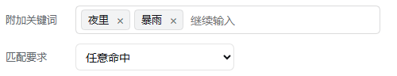

#### 匹配方式

普通文字直接找你填的字，打开「正则表达式」后可以用表达式来找。打开「忽略大小写」后，`CAT` 也能匹配 `cat`。对普通英文关键词开启「完整词匹配」后，`a cat` 能找到 `cat`，`catalog` 会跳过。

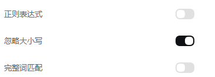

## 插入与顺序

### 在设定库选一个位置

在角色编辑器左侧打开 **「设定库」**，选中要配置的条目。在右侧切到 **「设置」**，打开触发规则，选择 **「常驻触发」→「指定插入位置」**。

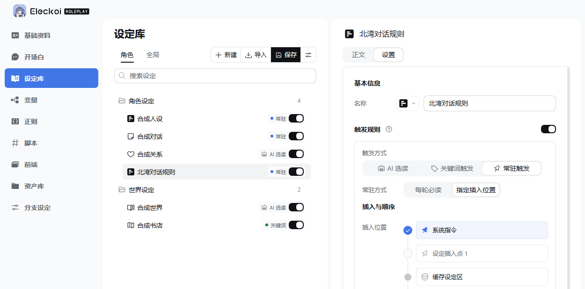

在右侧 **「插入与顺序」** 里选「系统指令」或一个设定插入点。选中后，该行左边会出现勾选标记。

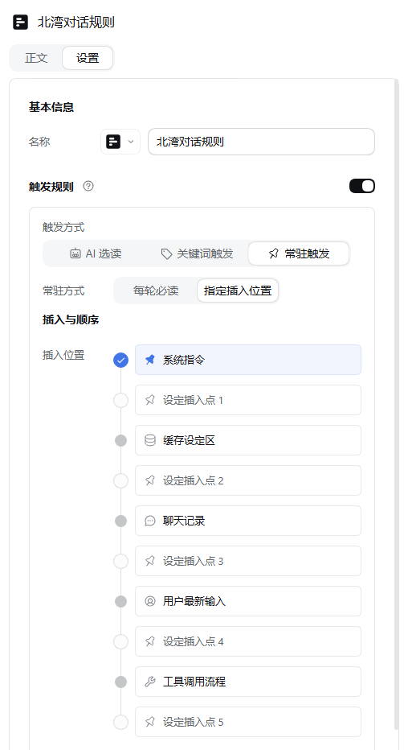

<figure class="tutorial-flowchart">
  
</figure>

<h3 id="内置位置从上往下怎么看">请求里的五个区块</h3>

软件按界面从上到下的顺序，把这些内容组装成发给 AI 的请求。以玩家问「我现在能出港吗？」为例。

#### 系统指令

设定选到这里，正文会与模型配置中的系统提示词一起发送，成为系统指令的一部分。

#### 缓存设定区

这里提前放入设为「每轮必读」的普通文字。例如「守夜人伊岚」的人设会带着编号放在这里。AI 调用读取工具确认时，工具返回编号和标题，指向已经收到的正文。同样设为「每轮必读」的 EJS 则由读取工具返回当轮生成的正文。

#### 聊天记录

这里放本轮输入之前带给 AI 的对话历史，包括用户和 AI 之前说的话。比如上一轮伊岚说过「今晚有大雾」，这轮信息就能接着用。

#### 用户最新输入

这是玩家这一轮刚发的消息，比如「我现在能出港吗？」。它把前面的聊天历史和后面本轮产生的工具调用分开。

#### 工具调用流程

这里记录 AI 在这一轮已经发出的工具调用和收到的结果。例如 AI 查询潮汐表，工具返回「今晚 21 点低潮」。同一轮后续请求会带上这些记录。还没调用工具时，这一段为空。

<h3 id="五个设定插入点怎么选">五个设定插入点的顺序</h3>

在角色设定库里，可以直接选「系统指令」或带图钉的插入点。「缓存设定区」「聊天记录」「用户最新输入」和「工具调用流程」由软件填入，选它们前后相邻的插入点即可。

| 插入点 | 正文在请求中的位置 |
| --- | --- |
| **设定插入点 1** | 系统指令之后、缓存设定区之前。 |
| **设定插入点 2** | 缓存设定区之后、聊天记录之前。 |
| **设定插入点 3** | 聊天记录之后、用户最新输入之前。 |
| **设定插入点 4** | 用户最新输入之后、工具调用流程之前。 |
| **设定插入点 5** | 本次请求已有的工具调用和结果之后。本轮尚无工具记录时，仍排在插入点 4 后面。 |

### 设置消息身份和顺序

选「系统指令」时，正文直接作为系统指令的一部分。五个设定插入点可选 **「消息身份」**，让正文以「用户」或「AI」消息的形式发给模型。

**位置内顺序**在同一个位置里生效，数字越小越靠前。比如同位置有 `1` 和 `3`，填 `2` 就会放在中间。若和已启用的条目撞号，编辑器会关闭这条的触发规则。换一个数字，再开启并保存。

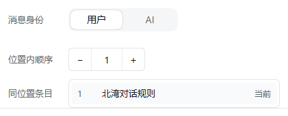

选好位置和顺序后，点设定目录上方的 **「保存」**。

酒馆设定导入时会忽略原来的插入深度。[为什么忽略插入深度](#为什么忽略插入深度)

<h2 id="ejs-in-entry">正文里的 EJS</h2>

**EJS 是设定正文里的动态文本生成器。** 你先写好「什么情况下输出哪段文字」。处理这条设定时，ElecKoi 把当前的对话和变量交给模板，模板按你写的条件产出对应的文字。条件不成立时，也可以换一段文字，或者留空。

<figure class="tutorial-flowchart">
  
</figure>

### 条件可以看什么

EJS 用 JavaScript 写条件。先取到你要用的信息，再判断次数、文字、数值、某件物品在不在清单里，也可以把几个条件合起来判断。

#### 消息范围

- **按消息数判断。** `getChatMessages().length === 20` 在当前聊天正好有 20 条消息时成立。玩家消息和 AI 回复都参与计数。写 `>= 20` 表示从第 20 条起。
- **先选谁说的，再选哪几条。** `lastUserMessage` 是玩家最近一次输入，`getChatMessage(-1, "assistant")` 取 AI 最近一条回复。`getChatMessages(-5, "user")` 取最近 5 条玩家输入，`getChatMessages(0, 3)` 取开头 3 条消息。范围从 `0` 起算，起点算进去，终点停在前一条。负下标从末尾数。
- **查这些发言有没有提到某件事。** `lastUserMessage.includes("灯油用完了")` 只看玩家最近一次输入。`matchChatMessages(/警钟|三响/, { start: -3, role: "user" })` 用正则检查最近 3 条玩家输入。范围留空时默认看最近 2 条。要同一条消息同时出现「警钟」和「三响」，可以写 `matchChatMessages(["警钟", "三响"], { and: true })`。

#### 变量作用域

模板用的是**当前这局聊天的变量值**。你在角色卡的[变量](#变量)页定义变量和开局值，对话里的条件读取这局现在的值。`getvar()`、`getLocalVar()`、`variables` 和 `stat_data` 读的是同一份聊天状态。

- **章节、地点、路线。** `getvar("剧情.章节") === 2` 可以判断是否进入第二章。地点也可按文字比较，例如 `getvar("剧情.地点") === "北湾港"`。
- **余量、关系、任务。** `getvar("补给.灯油", { defaults: 0 }) <= 0` 判断灯油耗尽，变量还没有值时按 `0` 算。好感度可以判断阈值，任务完成可以判断布尔值，例如 `getvar("任务.修复灯塔") === true`。
- **背包、名单、嵌套资料。** 如果「背包.物品」是文字列表，`getvar("背包.物品", { defaults: [] }).includes("备用灯油")` 就能查背包里有没有备用灯油。也可以用 `_.get(variables, "补给.灯油", 0)` 从对象里取值。

常规角色聊天交给模板的楼层信息是发言文字和角色。需要判断「比上一轮多了多少」时，可以在这局的变量里另外保存上一次的值。

需要另一条设定里的文字时，也可以用 `await getwi("灯塔断光")` 取回正文，再拿它判断或接进输出。[查看引用写法](#取用其他设定的正文)

#### 几个条件一起用

打开设定的 **「正文」**，可以把普通文字和 EJS 写在一起。`&&` 要求两个条件都成立，`||` 要求至少一个成立，`!` 表示条件不成立。下面先判断灯油余量，再看最近的发言里有没有提到警钟。

```ejs
<% const oil = getvar("补给.灯油", { defaults: 3 })
   const heardBell = matchChatMessages(/警钟|三响/, { start: -3, role: "user" })
   if (oil <= 0 && heardBell) { %>
灯塔已熄灭，外海又传来遇险信号。伊岚把手灯交给玩家，自己下到平台确认船的位置。
<% } else if (oil <= 0) { %>
灯塔已熄灭。伊岚提着手灯，请玩家一起去看守室拿备用灯油。
<% } else { %>
灯塔还亮着。伊岚留在塔顶观察海面，为靠近暗礁的渔船指路。
<% } %>
```

这里的 `else if` 会在第一种情况不成立时继续判断，`else` 是剩下的情况。想在所有条件都不成立时留空，就省去 `else` 那段。编辑器会在正文上方显示 **「已识别 EJS」**。

### 什么时候处理正文？

**触发规则管执行时机，EJS 条件管输出哪段文字。** ElecKoi 可以在准备模型请求时处理模板，也可以在 AI 查设定库时处理。模板里的条件使用处理当时的聊天消息和变量。

| 设置 | 执行时机 | 结果去哪 |
| --- | --- | --- |
| AI 选读 | AI 按路径打开条目时。 | 读取工具交回生成的正文。 |
| 关键词触发 | 设定工具准备本轮资料时，先按配置匹配关键词，命中才处理 EJS。 | 有输出就列入本轮必读，AI 用工具读取正文。 |
| 常驻触发 · 每轮必读 | 设定工具准备本轮资料时。 | 有输出就列入本轮必读，AI 用工具读取正文。 |
| 常驻触发 · 指定插入位置 | 本轮准备模型请求时。 | 有输出就放到你选的位置。 |
| 触发规则关闭 | 其他模板通过 `getwi` 取用时。 | 结果交回引用方，随引用方的规则发送。 |

如果另一条 EJS 用 `getwi()` 引用这条设定，它会在引用发生时处理，使用同一份聊天消息和变量。

### 关闭触发规则后

关闭规则的正文可以留作素材。普通文字原样返回，EJS 执行后把结果交回引用方。引用方输出这些文字时，整段结果按引用方的规则发送。

<figure class="tutorial-flowchart">
  
</figure>

### 例子：灯油用完才切换场景

**先建素材「灯塔断光」。** 在「正文」写好条件和场景文字，保持触发规则关闭。这里用 `lastUserMessage` 判断玩家最新一条消息有没有提到灯油用完。

```ejs
<% if (lastUserMessage.includes("灯油用完了")) { %>
灯塔的最后一点灯光熄灭了。伊岚提着手灯赶到下层平台，先敲三下警钟，再请玩家去看守室取备用灯油。
浓雾里传来一声回铃。伊岚听不清回铃从哪边来，只提醒玩家避开礁石。
<% } %>
```


**再建引用方「灯塔状况」。** 在它的「正文」里引用刚才的素材，再把「灯塔状况」设为 **「常驻触发」→「指定插入位置」**，选好位置后保存。

```ejs
<%- await getwi("灯塔断光") %>
```

发「灯油用完了」，「灯塔状况」就会取回断光的场景文字，放进你给「灯塔状况」选的位置。发「我走进灯塔」时，素材返回空文字，引用方这一轮没有正文可插入。

### 取用其他设定的正文

用 `getwi` 时填设定的准确名称。不同文件夹里有同名条目时，写完整路径。比如你把「灯塔断光」放进「场景」文件夹，就可以写 `getwi("场景/灯塔断光")`。改名或移动后，要更新引用中受影响的名称或路径。

<figure class="tutorial-flowchart">
  
</figure>

被引用的设定可以关着触发规则，或者还没命中自己的关键词。

以前用独立入口建的引用条目，升级后会合并成规则关闭的普通设定，继续供 `getwi()` 按名称或路径取用。

</div>

##### 变量

变量用来记录对话里会变的东西。比如创建一个名叫「好感度」的数字变量，初始值填 `0`。剧情推进后，Agent 可以按角色规则更新它。

##### 正则

正则可以替换普通文字，也可以把消息里的标记换成 HTML 源码，让 ElecKoi 在这条消息里渲染界面。比如把角色回复里的状态数据变成一张带血条的卡片。消息还是在聊天列表里，读者照常用原来的输入框聊天。

##### 脚本

脚本是随角色卡保存的小程序。比如做一个背包面板，读出当前对话的物品，再显示给玩家。

##### 前端

启用独立前端后，整个对话内容区都交给你的页面，包括聊天正文、输入框和底部操作。比如做一张冒险地图，让玩家点地点或按钮推进剧情。

[正则](#正则)生成的界面只在单条消息里显示，比如在角色回复里放一张状态卡。

##### 资产库

前端卡用到的背景图、立绘、按钮图标和音效都可以放进这张角色卡的资产库。比如先把地图和海浪声导入资产库，再在[独立前端](#前端)里引用它们。

##### 分支设定

分支设定让 Agent 随剧情更新当前对话里可修改的设定。比如这一局灯塔被风暴摧毁，Agent 可以把「灯塔已毁」记到这局的设定里。改动只在本局生效，角色卡的主设定照旧，开新一局时灯塔依然完好。

#### 许愿式 Agent 写卡

1. 打开「AI 创作工作室」，新建对话，选择上一步创建的角色。
2. 直接说你想做什么。例如「把这个角色写成灯塔守夜人，语气冷静。在设定库写一条背景设定，再写一条开场白，保留角色名字。」
3. Agent 执行后，到角色编辑器查看设定库和开场白。还想改哪里，就在同一工作室对话里说明。

#### 角色卡导出

**Windows**　在「角色」页点上方的 **「导出角色」**，选中要导出的卡，选 PNG 或 ZIP，再点「导出」并选保存位置。只导出一张时，也可以右键点该卡，直接选「导出角色」下的格式。


**Android**　点角色页右上角的「角色操作」→「导出角色卡」，选择卡片和格式后确认。

PNG 角色卡把数据放进图片里。分享时发送 PNG 原文件。ZIP 则把角色和素材打成一个包，适合整包分享。

### 酒馆玩家 Windows 电脑端

- [模型配置](#模型配置)
- [设定库基础操作与世界书导入](#设定库)

点击左侧边栏的「消息」，进入消息页面。

### 新手玩家 Android 手机端

[查看共用的五步新手教程](#新手玩家-windows-电脑端)

### 酒馆玩家 Android 手机端

- [模型配置](#模型配置)
- [设定库基础操作与世界书导入](#设定库)

## 概念词库

### 模型提供商

提供 AI 模型服务的厂商或平台。

在 ElecKoi 新建模型配置时，先选你实际开通服务的平台，再使用那个平台提供的 API Key、地址和模型 ID。

### Provider ID

DSH 用来定位某个提供商连接配置的唯一标识。

在 DSH 的通用模型适配器里，Provider ID 用于选择连接配置。配置中保存着 API 地址、接口格式和凭据引用。ElecKoi 为自定义配置保存密钥时，默认由该 ID 派生凭据名。例如 `google-relay-xx` 对应 `GOOGLE_RELAY_XX_API_KEY`。这是内部凭据名，用户只需在 API Key 栏填写实际密钥。

### 接口格式

客户端和服务端约定的请求及响应格式，包括路由、字段和流式返回方式。

ElecKoi 的四个选项分别对应 Responses、Chat Completions、Messages 和 Generate Content。以你填写的 API 地址所对应的服务文档为准，同一款模型也可能经不同接口提供。[OpenAI Responses](https://developers.openai.com/api/reference/resources/responses/methods/create) · [OpenAI Chat Completions](https://developers.openai.com/api/reference/resources/chat/subresources/completions/methods/create) · [Anthropic Messages](https://platform.claude.com/docs/en/api/messages/create) · [Gemini Generate Content](https://aistudio.google.com/api-reference/generate-content)

### API Key

模型服务发放给账户或项目的凭据，客户端在调用 API 时用它通过鉴权。

服务端据此识别请求归属，并按服务规则检查权限、记录用量。Key 的用法像一张单独的通行证，可以在服务商控制台管理或撤销。填写从控制台获得的密钥，妥善保管。

### API 地址

用于构造模型请求 URL 的基础地址（Base URL）。

地址包含服务的域名，也可能带 `/v1` 等路径。ElecKoi 的适配器依据所选接口格式使用相应的请求路径。为内置提供商配置时可先用默认地址。自定义配置填写服务商给出的基础地址。

### 模型

读取对话内容并生成 AI 回复的程序。

同一个模型提供商通常有多个模型。模型影响回复风格、速度和使用费用，角色设定则决定它在对话里扮演谁。

### 模型 ID

提供商用来识别具体模型或模型版本的字符串。

手动添加时使用当前服务文档或模型列表返回的完整 ID，包括服务商规定的版本后缀。同一模型在不同平台上的 ID 可能不同。[Gemini 模型列表接口](https://aistudio.google.com/api-reference/models)

### 上下文窗口

模型在一次请求中能处理的上下文容量，以 token（模型处理文本等内容的计量单位）计。

系统提示、角色设定、历史消息和当前输入都会用掉上下文预算。上下文与输出如何共享限额，以具体服务文档为准。ElecKoi 的设置用于本地估算与管理上下文，实际容量由模型服务决定。[Gemini 模型元数据](https://aistudio.google.com/api-reference/models)

### 自动压缩阈值

ElecKoi 触发对话上下文自动压缩的 token 水位。

界面默认按上下文窗口的 80% 计算。达到阈值时，可以用摘要代替一部分较早的对话上下文，为后续对话留出空间。

### 单次最大输出

一次请求允许生成的 token 上限。

不同接口对输出 token 的计量方式不同，有的也会计入推理 token。在 ElecKoi 留空时使用服务端默认值。[OpenAI Responses](https://developers.openai.com/api/reference/resources/responses/methods/create) · [Anthropic Messages](https://platform.claude.com/docs/en/api/messages/create)

### 推理强度

支持推理的模型在当前请求中使用的推理档位。

档位影响模型分配给推理的计算量，可能影响延迟和用量。「支持推理档位」描述这个模型及接口能接受哪些档位，「推理强度」选择本次请求用的档位。[OpenAI Responses](https://developers.openai.com/api/reference/resources/responses/methods/create)

### 输入能力

模型通过当前接口可以接收的内容类型，例如文本和图片。

能接收图片表示模型可以把图片作为输入来理解，生成图片属于另一种能力。自定义提供商按实际接入平台的模型或接口文档声明。[Gemini Generate Content](https://aistudio.google.com/api-reference/generate-content)

### 温度

控制采样时候选 token 概率分布的参数。

在支持该参数的接口中，较低的温度通常使生成更偏向高概率选项，较高的温度会让低概率选项更容易被采到。留空时 ElecKoi 不主动发送这个参数。[OpenAI Chat Completions](https://developers.openai.com/api/reference/resources/chat/subresources/completions/methods/create)

### Top P

核心采样的累计概率阈值，取值范围为 0 到 1。

采样时按概率从高到低纳入候选，直到累计概率达到阈值，再从这个集合采样。`0.9` 指累计概率约为 90%，关心的是概率总量。留空时使用服务端的默认行为。[OpenAI Chat Completions](https://developers.openai.com/api/reference/resources/chat/subresources/completions/methods/create)

### 网络代理

在客户端和目标服务之间转发请求的网络中间环节。

网络代理决定请求的传输路径。ElecKoi 当前由 DSH 适配器沿用系统代理，模型服务的目的地仍由 API 地址指定。[HTTP Semantics · 中间方](https://www.rfc-editor.org/rfc/rfc9110.html#section-3.7)

### 请求头

随 HTTP 请求一起发送的附加信息，比如接口版本或测试功能开关。

看服务商文档标在哪个位置。`Header` 是请求头，`Body` 是请求正文，`Query` 是 URL 上的参数。ElecKoi 的「自定义请求头」只往请求头里加内容。API Key 照常填在专用的密钥栏。[HTTP Semantics · 字段](https://www.rfc-editor.org/rfc/rfc9110.html#section-5)

### 角色卡

保存一个角色的资料和扮演设定的文件。

角色卡可以包含角色名字、简介、头像和开场白等内容。导入角色卡后，可以在角色列表找到它，再进入对话。

### 插入深度

酒馆世界书用它决定设定插在对话的哪里。D0 在本轮提示词末尾，数字越大，往旧消息里插得越靠前。

酒馆世界书的「扫描深度」决定往回找几条消息里的关键词。正则的「最小深度／最大深度」决定规则对哪几条消息生效。[酒馆世界书文档](https://docs.sillytavern.app/usage/core-concepts/worldinfo/) · [酒馆正则文档](https://docs.sillytavern.app/extensions/regex/)

要调整导入后的设定，在角色编辑器里打开「设定库」并选中条目，切到「设置」。打开「触发规则」，选「常驻触发」→「指定插入位置」。如果想让它靠近本轮输入，可以选「用户最新输入」附近的设定插入点。[查看插入与顺序教程](#插入与顺序)

#### 为什么忽略插入深度

同一段设定放在第几条旧消息旁，不同模型读出来的效果可能不同，很难靠一个固定数字让模型更重视它。[长上下文位置研究](https://aclanthology.org/2024.tacl-1.9/)

比如把设定始终放在倒数第三条消息前，每多一条消息，设定在历史里的位置就会往后挪。提示词缓存只能复用两次请求从开头起一致的部分。设定一挪，这段相同的开头就可能变短。ElecKoi 保留最新输入前后两个位置，常用的提示依然能放在本轮对话附近，也省得数消息。[前缀缓存说明](https://developers.openai.com/api/docs/guides/keep-prefix-unchanged)

## 设计理念

### 为什么叫设定库

**酒馆的世界书，怎么连人设也写在里面？**

「世界书」听起来像是只放世界观。实际写卡时，很多酒馆作者会把主要人物的人设也放进去，和人物关系、世界背景一起整理。

<p class="tutorial-pain-point">痛点：同一段人设，有人填在人设框里，有人放进世界书。第一次写卡的人不知道该填哪儿。</p>

**为什么换名字？**

写卡模板可以拿来参考。把模板做成固定入口，容易让人以为每种内容都只能填在一个地方。ElecKoi 用「设定库」装各类设定。比如写一张灯塔卡，可以建「守夜人的性格」「岛上的灯塔」「点灯要用灯油」三条，再按需要用文件夹整理。

**现在该写在哪？**

- **基础资料**填名字、头像和简介。
- **设定库**写详细人设、世界观和玩法规则，给 Agent 用。
- **开场白**写玩家进场时看到的内容。
